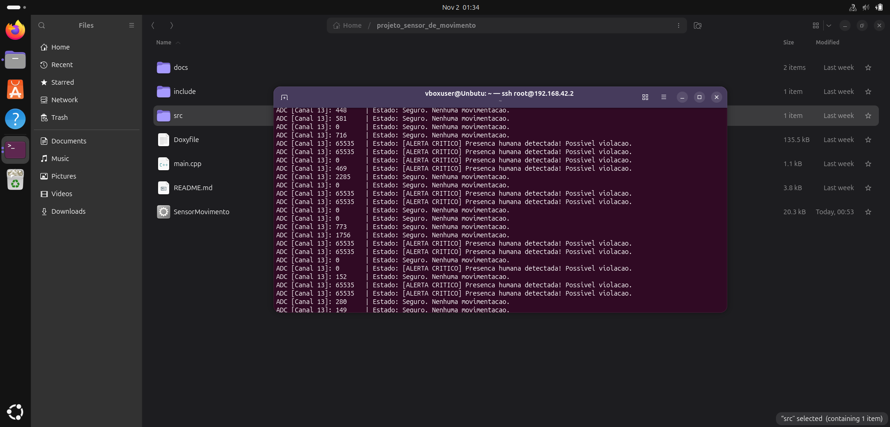
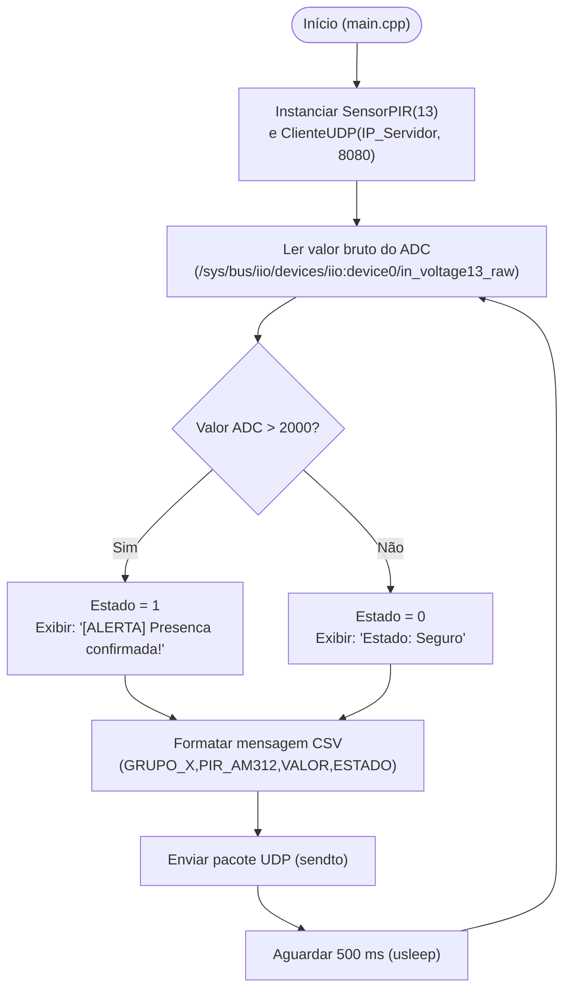
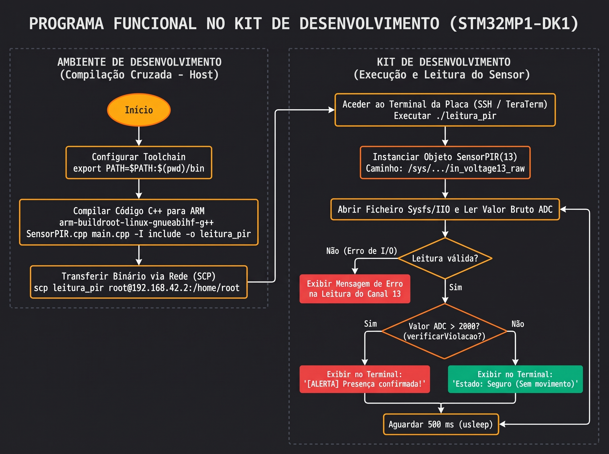
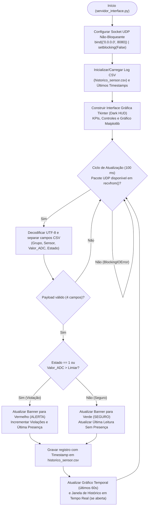
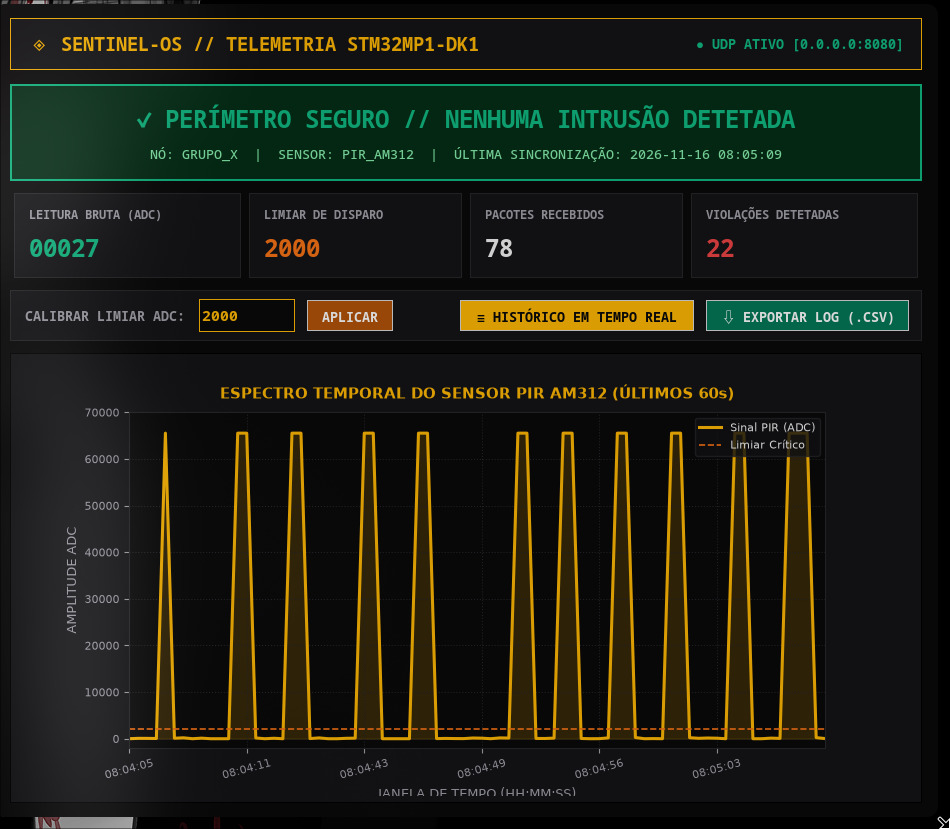
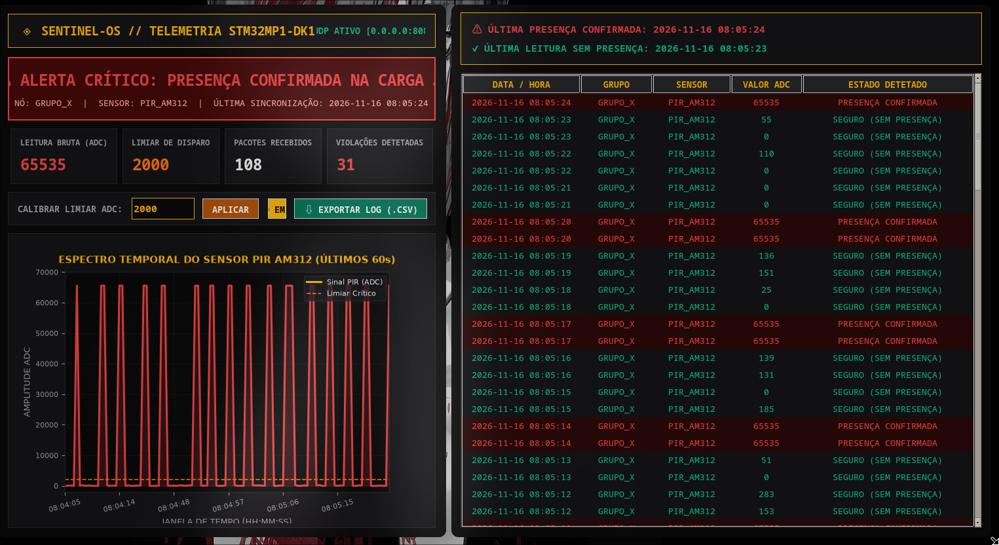
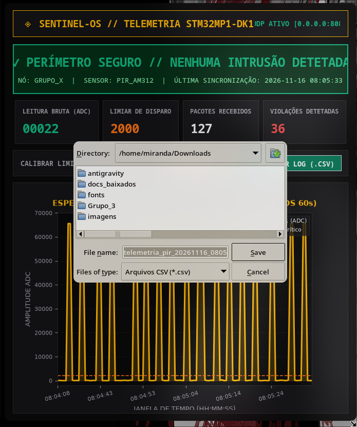

# Monitoramento Inteligente de Carga - Sensor de Presença (PIR) - GRUPO MEDEIROS_LIMA / GOMES / ARAUJO

## 📌 Descrição Geral do Projeto

Este projeto faz parte do sistema de **Monitoramento Inteligente de Carga**, desenvolvido em C++ para o kit de desenvolvimento embarcado **STM32MP1 DK1**. O objetivo é garantir a segurança de cargas sensíveis durante o transporte militar.

O escopo deste repositório abrange a integração e controle do **Módulo Sensor de Presença PIR Digital (AM312)**. O sensor é responsável por detectar a presença humana não autorizada próxima à carga. Ao final do projeto, os dados deste módulo serão transmitidos via UDP para um servidor central, compondo a rede de Internet das Coisas (IoT) tática.

## 🛠 Dependências Necessárias

* **Hardware:**
  * Kit de desenvolvimento **STM32MP157F-DK1**[cite: 7]
  * Módulo Sensor de Presença PIR Digital (**AM312**)
  * Cabos *jumpers* (ligação VCC 3.3V, GND e Sinal no pino analógico)[cite: 8, 11]
  * Cabo Ethernet (RJ45) e cabo Micro-USB (consola serial)[cite: 7]
* **Ambiente Embarcado (Kit e Compilação Cruzada):**
  * Sistema Operativo Linux Embarcado (Buildroot) no kit[cite: 7]
  * Toolchain de compilação cruzada `arm-buildroot-linux-gnueabihf`[cite: 6]
  * Subsistema IIO do Linux (`/sys/bus/iio/devices/iio:device0/`)
  * Ferramenta **Doxygen** (para geração da documentação HTML do código)
* **Servidor Central (PC Windows/Linux):**
  * **Python 3.x**
  * Biblioteca `tkinter` (interface gráfica nativa do Python)
  * Biblioteca `matplotlib` (gráfico temporal em tempo real):
    ```bash
    pip install matplotlib
    ```

---

## 📂 Estrutura do Código e Classes

### Organização de Diretórios
```text
├── include/
│   ├── SensorPIR.hpp        # Declaração da classe de leitura do sensor PIR
│   └── ClienteUDP.hpp       # Declaração da classe de comunicação UDP
├── src/
│   ├── SensorPIR.cpp        # Implementação da leitura ADC via sysfs/IIO
│   └── ClienteUDP.cpp       # Implementação do socket UDP (POSIX)
├── imagens/                 # Capturas de ecrã e evidências das entregas
├── main.cpp                 # Aplicação principal (integração SensorPIR + ClienteUDP)
├── servidor_interface.py    # Servidor UDP e interface gráfica (Tkinter + Matplotlib)
├── Doxyfile                 # Ficheiro de configuração da documentação Doxygen
└── README.md                # Documentação geral do projeto

### 5\. Compilação Cruzada do Código C++ com UDP (na VM Linux)

Na raiz do diretório do seu projeto (`projeto_sensor_de_movimento`), compile o código unindo todas as classes geradas:

```sh
arm-buildroot-linux-gnueabihf-g++ src/SensorPIR.cpp src/ClienteUDP.cpp main.cpp -I include -o Monitoramento_UDP
```
O sistema foi modelado com foco no encapsulamento orientado a objetos, garantindo a ausência de variáveis globais e facilitando a futura integração.

* **`include/SensorPIR.hpp`**: Arquivo de cabeçalho. Contém a declaração da classe `SensorPIR`, devidamente documentada com Doxygen.
* **`src/SensorPIR.cpp`**: Arquivo de implementação. Realiza a leitura física interagindo com o subsistema IIO do Linux (`/sys/bus/iio/devices/...`).
* **`main.cpp`**: Arquivo principal de execução do loop de monitoramento contínuo.

### Detalhamento da Classe `SensorPIR`

* **Atributos (Privados):**
  * `m_caminho_arquivo`: Armazena o caminho do arquivo do canal ADC correspondente.
  * `m_limiar`: Valor de tensão bruta mínima (offset) para considerar a detecção de movimento.

* **Métodos (Públicos):**
  * `SensorPIR(int canal_adc, int limiar_deteccao)`: Construtor que mapeia o canal descoberto no kit (ex: canal 13).
  * `lerValorBruto()`: Acessa o arquivo lógico no sistema de arquivos do kit e retorna o valor inteiro atual.
  * `verificarViolacao()`: Compara a leitura com o limiar, retornando `true` se houver intrusão.

## ⚙️ Instruções de Compilação e Execução (Entrega 2)

Este sistema foi projetado para ser executado no espaço de usuário Linux do kit STM32MP1-DK1. Siga os passos abaixo na sua Máquina Virtual Linux para compilar e testar o monitoramento no hardware:

### 1. Compilação Cruzada (Cross-Compilation)
No terminal da máquina virtual Linux, utilize a toolchain fornecida para gerar o executável compatível com a arquitetura ARM da placa. Na raiz do projeto, execute:

```bash
arm-buildroot-linux-gnueabihf-g++ src/SensorPIR.cpp main.cpp -I include -o SensorMovimento
```

*(Nota: Certifique-se de que a toolchain esteja no seu PATH ou utilize o caminho completo até o binário).*

### 2. Transferência para o Kit (via SCP)
Com o kit energizado (cabo na porta PWR_IN) e conectado à rede via cabo Ethernet, envie o arquivo executável gerado para a placa via SCP. Substitua `<ip_da_placa>` pelo IP real do kit (ex: `192.168.42.2`):

```bash
scp SensorMovimento root@<ip_da_placa>:/home/root
```
*(A senha padrão do usuário root é `root`).*

### 3. Execução no Hardware Embarcado
Acesse o terminal do kit através de uma conexão SSH (ex: `ssh root@192.168.42.2`) ou via cabo serial (TeraTerm) e execute o programa:

```bash
./SensorMovimento
```
O programa iniciará o monitoramento contínuo em tempo real, exibindo as leituras do canal 13 do ADC e emitindo alertas no console caso o sensor PIR detecte presença humana.


---

### Fluxograma do Programa Funcional no Kit (STM32MP1-DK1)



### 4\. Protocolo UDP

 A comunicação entre o kit embarcado STM32MP1-DK1 e o computador central utiliza o protocolo **UDP (*User Datagram Protocol*) sobre IPv4 (`SOCK_DGRAM`)** na **porta 8080**, escolhido por dispensar estabelecimento de conexão (*handshake*) e confirmação de entrega (*ACK*), garantindo baixa latência e envio contínuo em tempo real pela rede local Ethernet. Na camada de aplicação, as mensagens seguem um protocolo proprietário em texto plano estruturado no formato **CSV (`GRUPO,SENSOR,VALOR_ADC,ESTADO`)**, permitindo que o servidor Python decodifique, valide e atualize instantaneamente os alertas visuais, o gráfico temporal e o arquivo de log. 
 
 ```mermaid
flowchart LR
    subgraph Cliente ["Cliente Embarcado - STM32MP1-DK1 (C++)"]
        C1(["Início"]) --> C2["Criar Socket UDP (SOCK_DGRAM)<br/>e configurar IP_Servidor : Porta 8080"]
        C2 --> C3["Ler ADC e montar payload CSV<br/>'GRUPO_X,PIR_AM312,VALOR,ESTADO'"]
        C3 --> C4["Transmitir datagrama via sendto()<br/>(Envio direto sem handshake)"]
        C4 --> C5["Aguardar 500 ms (usleep)"]
        C5 --> C3
    end

    subgraph Rede ["Rede Local"]
        R1(("Datagrama UDP/IPv4<br/>Porta 8080"))
    end

    subgraph Servidor ["Servidor Central - PC (Python)"]
        S1(["Início"]) --> S2["Abrir Socket UDP (0.0.0.0:8080)<br/>Modo não-bloqueante"]
        S2 --> S3{"Pacote disponível<br/>em recvfrom()?"}
        S3 -- "Não" --> S3
        S3 -- "Sim" --> S4["Decodificar UTF-8 e validar CSV"]
        S4 --> S5["Atualizar Interface Gráfica<br/>e salvar em historico_sensor.csv"]
        S5 --> S3
    end

    C4 -. "Envio contínuo" .-> R1
    R1 -. "Recepção assíncrona" .-> S3
 
 
### 6\. Transferência para o Kit STM32 (via SCP)

Com a placa energizada e o cabo de rede conectado, envie o arquivo executável para o diretório `/home/root`:

```sh
scp Monitoramento_UDP root@192.168.42.2:/home/root
```

### 7\. Execução no Hardware (via SSH)

Acesse remotamente o terminal da placa e inicie o programa embarcado:

```sh
ssh root@192.168.42.2
./monitoramento_udp
```

*(Neste momento, a interface gráfica no seu PC começará a plotar o gráfico em tempo real).*

### Fluxograma do funcionamento do sistema

```mermaid
flowchart TD
        A(["Início (main.cpp)"]) --> B["Instanciar SensorPIR (Canal 13)<br/>e ClienteUDP (Porta 8080)"]
        B --> C["Ler ADC: /sys/bus/iio/devices/iio:device0/in_voltage13_raw"]
        C --> D{"Valor ADC > 2000?"}
        D -- "Sim" --> E["Estado = 1 (Violação)<br/>Terminal: 'Presença confirmada!'"]
        D -- "Não" --> F["Estado = 0 (Seguro)<br/>Terminal: 'Estado: Seguro'"]
        E --> G["Formatar payload CSV:<br/>GRUPO_X,PIR_AM312,VALOR,ESTADO"]
        F --> G
        G --> H["Enviar datagrama via Socket UDP"]
        H --> I["Aguardar 500 ms (usleep)"]
        I --> C
    end

    subgraph PC ["Servidor Central - PC (Python)"]
        J(["Início (servidor_interface.py)"]) --> K["Abrir Socket UDP (0.0.0.0:8080)<br/>e inicializar GUI Tkinter"]
        K --> L{"Pacote UDP<br/>recebido?"}
        L -- "Não" --> L
        L -- "Sim" --> M["Decodificar e separar campos CSV"]
        M --> N{"Estado == 1?"}
        N -- "Sim" --> O["Alerta Visual: Fundo Vermelho<br/>'VIOLAÇÃO DETETADA'"]
        N -- "Não" --> P["Status Normal: Fundo Verde<br/>'SEGURO'"]
        O --> Q["Gravar registro com timestamp<br/>em historico_sensor.csv"]
        P --> Q
        Q --> R["Atualizar gráfico em tempo real<br/>(Matplotlib - últimas 60 leituras)"]
        R --> L
    end

    H -. "Rede Local (Ethernet / UDP)" .-> 
```
### 8\. Interface gráfica 

Atua como a central de monitoramento em tempo real no PC, abrindo um *socket* UDP não-bloqueante na porta `8080` para escutar continuamente os datagramas enviados pelo kit STM32MP1-DK1. A cada 100 milissegundos, o programa decodifica o pacote CSV recebido (`GRUPO,SENSOR,VALOR_ADC,ESTADO`), verifica se o valor ultrapassou o limiar calibrado e atualiza instantaneamente os cartões de telemetria, o banner de alerta visual (verde para perímetro seguro ou vermelho para presença confirmada) e o gráfico temporal dos últimos 60 segundos em Matplotlib. Paralelamente, cada leitura é gravada de forma persistente no arquivo `historico_sensor.csv`, permitindo ao operador exportar relatórios a qualquer momento ou abrir uma janela secundária sincronizada ao vivo com a data e a hora exatas da última presença confirmada e do último estado seguro. 

### Fluxograma da Interface Gráfica e Servidor Central (`servidor_interface.py`)


<h3>Interface do Sensor PIR (PYTHON)</h3>


<h3>Histórico de Presença</h3> 


<h3>Exportação .CSV</h3>


